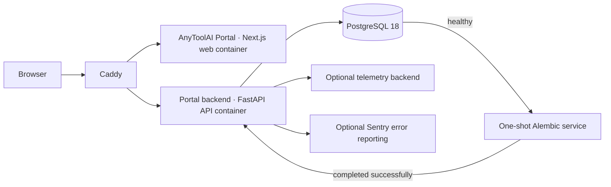

# Deployment Architecture

Status: authoritative current deployment plus target contour isolation
Last source review: 2026-11-12; deployment acceptance remains separate.

## Current `ru` deployment

The AnyToolAI Portal remains pre-production. This topology is the supported
deployment composition, not evidence of a launched billing service. Its web
entry combines public product discovery and the account/auth cabinet.



Production Compose builds web and API images and runs Alembic through a
one-shot `migrate` service after PostgreSQL becomes healthy. The API depends on
successful migration completion and its container command starts only Uvicorn;
a failed migration therefore blocks API startup. Only Caddy publishes host
ports, while PostgreSQL, API, and web remain internal. Production must provide
HTTPS termination, `ru` data residency, backups, secret storage, and
monitoring outside this repository's local Compose assumptions.

Both the API and migration service require explicit `INSTANCE_TENANT_ID` and
`INSTANCE_REGION` production environment values. `docker-compose.prod.yml`
fails interpolation when either is absent. The settings are normalized to
lowercase and are the implemented server authority for registration, login,
password reset, required legal-document discovery, authenticated session
scope, and legal writes. They are descriptive deployment identity, not
caller-selectable routing inputs. Local repository defaults are explicitly
`anytoolai` / `ru`; production has no silent contour default. The current
bootstrap and legal source support exactly `anytoolai` / `ru`. Settings,
Alembic bootstrap, and runtime legal seeding fail before successful startup or
bootstrap when a different tenant/region pair is configured. Enabling another
scope requires its dedicated contour/legal enablement ticket; the current
deployment variables are not a generic contour bootstrap selector.

The direct-provider and CloudPayments runtime has been physically removed.
The API implements configured External Billing source reads, purchase/Widget
flows, embedded polling/recovery and local paid projection/cabinet reads. Its
worker runs inside the API process; there is no separate worker service.
Production source conformance, metered vocabulary and launch retain their
acceptance gates. ANY-766 implements consumer-scoped snapshot V3, delegation V2, durable
recipient delivery, browser launch and usage integration. Step 16 verifies the
main local HTTP/browser journeys with explicitly labelled external substitutes. Remote installation/live acceptance belong to
ANY-767. Configuration and resource limits are in the
[billing runbook](../engineering/ANY-709-billing-runbook.md#connection-and-deployment)
and [worker operations guide](../engineering/billing-background-operations.md#embedded-worker-settings-and-resource-limits).

Production exposes optional `SENTRY_DSN` and `SENTRY_RELEASE` values to the
shared API/migration environment. An empty DSN keeps Sentry disabled; when a
production deployment supplies a DSN, it must use HTTPS and must also supply
the immutable release identifier through `SENTRY_RELEASE`. `APP_ENV` remains
the Sentry environment source and `OTEL_SERVICE_NAME` remains the
service-identity source. The repository does not hardcode a DSN, discover
releases from container git state, or expose separate Sentry enablement,
environment, service, sampling, debug, Spotlight, metrics, or logging switches.

Sentry is an optional outbound backend application-error destination, separate
from the optional OTLP telemetry backend. It does not own or receive tracing,
application logs, metrics, or profiling, and it does not replace persisted
database state as business truth. Project-side data scrubbing, disabled or
policy-compliant IP collection, and notifications for new or regressed
production issues are operator-managed settings; this repository does not
automate Sentry project management or broad monitoring owned by ANY-86.

`GET /api/health/live` reports only whether the API process can serve HTTP and
does not access PostgreSQL. `GET /api/health/ready` runs `SELECT 1` and returns
HTTP 503 with `{"status":"not_ready"}` when PostgreSQL is unavailable, without
returning database or exception details. Docker uses readiness for API health.
Caddy's `/api/*` proxy exposes both canonical health endpoints for external
monitoring such as HetrixTools. The supported health surface is limited to
these two endpoints; `/health`, `/health/live`, and `/health/ready` are removed
and return HTTP 404.

## Portal API ingress

The standalone dev/production Caddyfiles forward `/api/*` and the implemented
backend service endpoints to API using Compose service DNS `api:8000`:
`/internal/v1/backend-sessions/exchange`,
`/internal/v1/backend-sessions/introspect`, `/internal/v1/access-snapshots/*`
and `/internal/v1/allowance-exhaustions`. `/docs`, `/docs/*` and `/openapi.json`
also reach API. Paths/query strings are preserved; all other paths reach web.
Changing the Compose project name does not change these upstreams.

Service routes retain their receiver-owned Bearer permissions, scope checks,
browser-Origin refusal and no-store responses. Verified HTTPS is required for
production service calls. Swagger documents the protocol; it does not bypass
the browser restriction or make service credentials browser-safe.

On a shared VPS, ANY-164's shared edge owns ports 80/443. Do not start this
stack's standalone `caddy` service there. Attach only API/web to the operator's
edge network and reproduce the path routing above with environment-scoped
aliases (for example `payments-staging-api` and `payments-staging-web`). Keep
databases private and staging aliases/hostnames separate from production.
The infrastructure owner supplies the actual network, aliases and verified
TLS endpoints; ANY-767 verifies them on the installed pair. A direct API
healthcheck does not prove edge routing. Smoke-test service refusals, actual
exchange/snapshot calls, Swagger and ordinary web routes through the edge.

## Target contour deployments

Each production contour is its own data plane: web, API, PostgreSQL and configured
External Billing credentials and objects. A `ru` instance
does not serve `eu` or `us`. No user or payment data may be silently replicated
between contour data planes.

Region Resolver is deployed separately. It is not part of this Compose stack.
This portal may later receive the resolver origin as instance configuration.
The conceptual user-facing destination is the AnyToolAI Portal for the selected
contour, with Platform Kernel as a separate API/service boundary; no separate
Application Portal peer frontend is required. The Resolver API schema remains
undefined, and this topology defines no response fields or client behavior.
The ANY-715 MVP build uses contour-local embedded polling and has no webhook
receiver. `/api/billing/lbx/webhook` returns 404; there are no receiver settings
to forward through Compose/harness. Keep polling enabled and use the
[polling-only operations guide](../engineering/billing-background-operations.md#polling-only-operation).
Retain existing receipt tables/history; this build does not process that inbox.

The clean baseline validates the configured scope and then bootstraps only the
currently supported `anytoolai` / `ru` contour and its RU country membership.
It never silently substitutes RU data for a different configured scope or
authorizes one production database to operate as two contours.

<a id="one-time-step-4-recreate-and-bootstrap"></a>

## One-time Step-4 recreate and current bootstrap

The Step-4 database is a destructive compatibility boundary. Pre-Step-4
application binaries must never run against it. A database stamped with any
discarded pre-Step-4 migration revision is recreated, not upgraded, downgraded,
stamped or bridged into the clean baseline. Image-only rollback across this boundary
is forbidden: rollback or recovery restores a matching application and
database baseline. Any reset, bootstrap, schema verification, or smoke failure
blocks rollout.

Retired post-Step-4 ANY-709 branch labels use the separately verified
[consolidation transition](../engineering/ANY-709-billing-runbook.md#consolidated-any-709-migration).
They must not be confused with discarded pre-Step-4 databases.

Before starting, identify the exact target application revision/image and
target environment, and record the pre-reset application/database pairing.
Stop every pre-Step-4 API, web, worker, and scheduler process that can access
the database and verify that it cannot restart against the clean database.

For the repository-managed local harness, read `worktree_id` and `compose_project` from
`.harness/runtime.json` or from the JSON previously printed by
`python scripts/repo.py up`. Keep the matching `.harness/runtime.env` and run
from the repository root, without process-level `DATABASE_URL` or `POSTGRES_*`
overrides from another environment:

```bash
python scripts/repo.py reset --confirm <worktree_id>
docker compose --project-name <compose_project> --env-file .harness/runtime.env \
  -f docker-compose.yml -f docker-compose.agent.yml \
  up -d --no-deps --no-build --pull never --wait postgres
python scripts/repo.py migrate-api
```

`reset` executes the harness-scoped Compose
`down --volumes --remove-orphans`, deleting the application's local volumes and
data while retaining the runtime metadata. This is a destructive local reset,
not a normal upgrade. The explicit Compose command starts only the application
PostgreSQL server; `migrate-api` applies `alembic upgrade head` to that harness
database. The healthcheck waits for TCP readiness, excluding the socket-only
temporary server used during cold initialization.
`test-db up` targets a separate disposable test project and port; it
does not start the application server and cannot replace this step. See the
[test-server lifecycle](../engineering/TESTING.md#test-environment-and-server-lifecycle).

The clean baseline migration owns schema creation and configured-contour/legal
bootstrap; subsequent revisions apply through the same `upgrade head`. The
[schema reference](payment-portal-data-model.md#physical-baseline) owns the
current migration chain and table inventory. Do not create a separate
bootstrap CLI. Before starting normal runtime on a fresh database, verify:

- Alembic reports one head and the database is at that head;
- the current head is `20261117_821_merge` and exactly 30 application tables exist;
- every removed legacy catalog/order/payment/provider/subscription/
  entitlement/trial table is absent;
- all seventeen billing/link/purchase tables are empty before explicit flows;
- only the configured contour/country state is present;
- the expected legal entity and six current legal document rows match the
  canonical legal source.

The [Step 10 consumer cutover](../contracts/product-backend-api/README.md#implemented-step-10-settings-and-cutover)
requires the updated Portal/Kernel/browser together. Migration 0009 preserves
retained delegation credentials; API startup installs the configured P/digest
guard. Old Kernel-only identity binaries are not a supported rollback.

After verification succeeds, start only the matching application stack:

```bash
python scripts/repo.py up --reuse --port-offset <original_port_offset>
```

Use the original `up` port offset (`0` if none was supplied), so runtime metadata
continues to identify the same application server. If needed, recover it as
the saved `postgres_port` minus `runtime_config().postgres_port` from
`scripts.repo` in this checkout.

The Compose `migrate` service runs the same `alembic upgrade head` before API
startup. The API legal seed remains an idempotent, fail-closed runtime check of
canonical legal material, not a second schema authority. Run retained
provider-independent registration, login, session, password-recovery, and
legal smoke checks.

For shared dev/test/pre-production environments, operators must use that
environment's authoritative process-stop and database destroy/recreate
mechanisms. This repository has no canonical shared-environment commands for
those actions, so the runbook does not fabricate them. The required order is
still: stop and fence old consumers; recreate the old-stamped database; apply
the current head/bootstrap from the matching build; perform the same
schema/bootstrap checks; start only the matching runtime; run the
provider-independent auth/legal smoke suite.

On any failure, keep rollout blocked. Recovery restores or recreates a matching
application+database pair. Never roll back only the image while preserving the
Step-4 database.

## Reviewed image installation (ANY-766 Step 17)

The optional `deploy/compose.images.yml` removes application build contexts and
selects `PORTAL_API_IMAGE` (also used by `migrate`) and `PORTAL_WEB_IMAGE` from the
operator's environment file. Use immutable registry digests after publication,
or unique reviewed version tags already present locally; `latest` and untagged
references are refused by `scripts/repo.py image-up`. The override never pulls.
The existing source-build Compose path remains available. These Linux commands
require a matching reviewed control checkout and Docker Compose supporting
`!reset`. No portable installer or additional release service is used.

`.github/workflows/publish-images.yml` is manually dispatched with `backend`,
`frontend` or `all`. Its default is build only; `publish=true` is a separately
authorized post-review GHCR action. Backend builds do not require frontend inputs.
Frontend builds require `APP_PUBLIC_BASE_URL` and `NEXT_PUBLIC_API_BASE_URL`.
Set the optional `NEXT_PUBLIC_KERNEL_WEB_BASE_URL` (workflow input
`kernel_web_base_url`) to the public Kernel launch base URL, including any base
path; empty keeps product launch links unavailable. The local harness forwards
this value from `.env`, with the process environment taking precedence. Compose
source builds pass it into the web builder, alongside the optional public
`NEXT_PUBLIC_SENTRY_DSN`. Runtime environment changes do not rewrite the browser
bundle; changing the launch URL requires rebuilding the web image.
Frontend image tags include the workflow run ID so
builds with different origins cannot silently share a source-only tag.
Never send backend consumer credentials as build arguments.

Prepare a private environment file from `.env.production.example`, with actual
scope, DB, browser origins and consumer credentials, plus the selected image refs.
Retain the existing Compose project/volume names on updates. An operator creates
one private directory and shared lock path for all control checkouts. After
review and explicit installation authorization, parameterized commands are:

```bash
ENV_FILE=/operator/portal/images.env
PROJECT=payments-portal-prod
LOCK=/operator/portal/locks/deployment.lock
# Pull only the reviewed digests, with separately authorized registry access.
# docker pull "$PORTAL_API_IMAGE"
# docker pull "$PORTAL_WEB_IMAGE"
./.venv/bin/python scripts/repo.py image-up --env-file "$ENV_FILE" \
  --project "$PROJECT" --lock-file "$LOCK"
# Frontend-only: existing compatible backend, migration and volumes are untouched.
./.venv/bin/python scripts/repo.py image-up --env-file "$ENV_FILE" \
  --project "$PROJECT" --lock-file "$LOCK" --frontend-only
# Standalone host only: shared VPS installations use their operator-owned edge.
docker compose --project-name "$PROJECT" --env-file "$ENV_FILE" \
  -f docker-compose.prod.yml -f deploy/compose.images.yml \
  up -d --no-deps --no-build --pull never caddy
```

For a shared VPS, the operator supplies a network-only overlay such as
`/operator/portal/network.yml` and sets its environment-scoped names in the same
`ENV_FILE` (`PORTAL_EDGE_NETWORK`, `PORTAL_API_ALIAS`, `PORTAL_WEB_ALIAS`):

```yaml
services:
  api:
    networks:
      edge:
        aliases: ["${PORTAL_API_ALIAS:?set the environment-scoped API alias}"]
  web:
    networks:
      edge:
        aliases: ["${PORTAL_WEB_ALIAS:?set the environment-scoped web alias}"]
networks:
  edge:
    external: true
    name: ${PORTAL_EDGE_NETWORK:?select the existing shared edge network}
```

Only API/web join the existing shared edge; PostgreSQL and `migrate` retain the
private backend network. Do not start standalone Caddy on this path. Supply the
same overlay for the initial installation and **every** full or frontend-only
update, retaining the existing project and lock:

```bash
NETWORK_OVERLAY=/operator/portal/network.yml
./.venv/bin/python scripts/repo.py image-up --env-file "$ENV_FILE" \
  --project "$PROJECT" --lock-file "$LOCK" --network-overlay "$NETWORK_OVERLAY"
./.venv/bin/python scripts/repo.py image-up --env-file "$ENV_FILE" \
  --project "$PROJECT" --lock-file "$LOCK" --network-overlay "$NETWORK_OVERLAY" \
  --frontend-only
```

The optional overlay path is relative to the caller's working directory.
Configuration validation and all update commands use the same file order:
production Compose, operator network overlay, then image selection. Omitting
the flag retains the standalone configuration; `COMPOSE_FILE` does not add
files to this explicit selection. A missing or invalid overlay fails at
`compose config` before any service is stopped.

`image-up` holds the deployment lock throughout: stop the API (including its
embedded worker), wait for retained PostgreSQL, run a fresh migration container
from the selected backend image, then start API only after migration success and
readiness, followed by web health (`--wait` for both). The default API stop grace is 75 seconds for the
default 60-second worker I/O budget; increase `PORTAL_API_STOP_GRACE_PERIOD` if
raising that budget, retaining time for cleanup. PostgreSQL readiness uses TCP
and a cold-initialization start period. A migration failure leaves the old API stopped; do
not restart it to bypass the failure. No command deletes volumes. Close public
ingress and disable all other producers/automation for the whole maintenance
window; the per-command lock does not replace that operational ownership. Take
and verify separate application/database backups before updating retained data.
Use the existing backup/recovery procedure and matching reader+database pair;
never repair failure by downgrading, stamping or rewriting purchase history.

### Billing operator CLI while the API is stopped

For [terminal purchase completion](../engineering/billing-background-operations.md#terminal-completion-any-821),
keep PostgreSQL running and use a one-off container from the deployed API image.
Use the deployment's project, protected environment file and Compose file order.
The example uses the reviewed-image installation. For a source-built installation,
omit `-f deploy/compose.images.yml` and use the project's already-built API image.
For a shared VPS, place `-f "$NETWORK_OVERLAY"` after `docker-compose.prod.yml`
and before the image override when that override is in use.
`run --no-deps` runs the CLI while the API service and its senders stay stopped.

Set `EVIDENCE_FILE` to the absolute path of the protected evidence file, readable
by the container user. Set the remaining arguments from the operator record.
Use the same effective UID for the original command and any exact replay.

```bash
docker compose --project-name "$PROJECT" --env-file "$ENV_FILE" \
  -f docker-compose.prod.yml -f deploy/compose.images.yml \
  run --rm -T --no-deps --pull never -e PYTHONPATH=apps/api \
  --volume "$EVIDENCE_FILE:/run/purchase-evidence.json:ro" \
  api python -m app.cli.billing_purchases resolve-purchase \
  --user-id "$USER_ID" --purchase-id "$PURCHASE_ID" \
  --expected-digest "$EXPECTED_DIGEST" --evidence-file /run/purchase-evidence.json \
  --reason "$REASON" --reference "$REFERENCE"
```

To inspect, use the same Compose invocation with the `inspect` action,
`--user-id` and `--purchase-id`. Omit the evidence mount. For a late case,
add `--case-id` to `resolve-purchase`.

### Paired compatibility and synchronized cutover

Deploy the ANY-821 Portal build with Alembic head `20261117_821_merge`. It joins
the published ANY-766 head `20261113_0013` and terminal resolution revision
`20261116_821`.

The reviewed ANY-766 source pair used Portal head `20261113_0013` and Kernel head
`0022`, with consumer identity V2, AccessSnapshot V3 and
manifest/invalidation/usage/exhaustion V1. Its source baselines were
Portal `2e328bb59af690ec3a4599da0ce4556f9bedce76` and Kernel
`c153aaa200770ee156537e30fea1ebb3d085b434`, plus their review corrections.
Earlier image rehearsals do not verify this corrected pair.
Record final reviewed source SHAs, actual image IDs/digests and all frontend
build inputs with the selected environment. Equal source labels or Alembic heads
alone do not establish application/peer compatibility.

The Portal reader floor includes the ANY-765 selected-consent digest fix and
ANY-766 Step 11: new product-link-v4 / purchased-technical-terms:v3 /
accepted-purchase:v4 histories require these readers even if the migration head
has not changed. Pre-selected-digest readers and pre-Step-11 readers are excluded.
No image-only rollback to them is supported. Historical documents/digests,
allowance IDs and quantities remain unchanged. The old Kernel-only delegation
API and snapshot V2 binaries are also excluded; there is no rolling mixed-wire
mode for this cutover.

Migration `20261116_821` refuses downgrade while a purchase retains
`resolved_external_terminal`, a `purchase_late_external_object` review is open,
or a terminal resolution audit retains a confirmed external object ID.
While any of these conditions holds, use a Portal image that can read and
enforce ANY-821 history. This requirement also applies to image-only rollback
against the retained database.
Even after a purchase was completed as `resolved_no_external_effect`, an open
late-object review requires a compatible Portal reader to block new financial
CREATEs for that customer. Confirming the object keeps the downgrade blocked.
Ruling it out removes that review's restriction.
The existing guards for retained V2 evidence, allowance activation and issuance
budgets still apply.
Keep the matching application and database backup together for recovery.

The earlier correction expanded the policy digest to include permissions and
technical source without a DB migration or wire-version change. When crossing
that digest boundary on an existing installation, stop Portal
API/workers and configure P **above the persisted P for every configured consumer**
before the first corrected startup. A fresh database may use P=1. Do not manually
edit policy rows, decrease P, or restart the old Portal binary against the expanded
digest merely because the migration head is unchanged. This changes P, not R,
purchase ownership, allowance IDs or usage. A consumer-ID change never transfers
historical purchases or delivery history. Keep that ID identical in the Portal
registry, Kernel API/worker environments and Kernel frontend build. The remaining
activation correction requires migration `20261113_0012` with API/workers stopped;
that migration alone does not require changing P.

The Kernel image installer also checks the web image's compiled consumer through
its `io.anytoolai.portal-consumer-id` label before installation or a frontend-only
replacement. Rebuild older unlabelled images; runtime variables cannot repair a
missing or foreign build audience. Compatible frontend/backend source revisions
may still differ.

For a paired cutover from the Step 8 baseline:

1. Close both ingress paths and stop Portal API/embedded workers and all extra
   producers. Use the running Kernel revision's `prod-quiesce` to stop admission,
   drain every `created/running` job, then stop workers. A failed drain keeps the
   worker running and blocks migration. Verify backups of both independent DBs.
2. Configure all consumers, source/owner mappings, directional credentials,
   fixed callbacks, allowed products and monotonic policy versions together.
   Preserve the existing Kernel audience and identity; never transfer retained
   allowance ownership by changing configuration. Enable Kernel invalidation and
   usage receiver permissions before enabling Portal delivery.
3. While both old application sets remain stopped, run the selected Portal
   `migrate` image to apply `alembic upgrade head`. Verify
   `20261117_821_merge` for the ANY-821 build. This head includes all ANY-766
   revisions through `20261113_0013` and the terminal resolution revision. The
   [schema reference](payment-portal-data-model.md#physical-baseline) lists
   their effects. Keep the old Portal API and workers stopped. Configure
   consumers before the updated API starts and verifies P/digest and recipient
   state.
4. Use the selected Kernel images and the Kernel runner through head `0022`
   for this compatibility baseline.
   `0020` retains R floors and usage/reservations while clearing incompatible
   cache metadata and initializing consumer/P; `0021` adds durable exhaustion;
   `0022` binds retained history to one consumer without changing usage/replay keys.
   Ambiguous ownership refuses migration; do not clear history to bypass it.
   Start only compatible API/worker binaries with the retained consumer ID; see
   [Kernel binding rules](https://github.com/gushinets/anytoolai-platform/blob/main/docs/contracts/portal-kernel-paid/README.md#service-requests-and-identity).
   Require profile generation, matching source checks, readiness and activation
   as documented in the Kernel deployment runbook. Retain both DB volumes.
5. Start the matching Portal API/web with `image-up`, verify auth/access and
   independent recipient recovery, then reopen ingress only after the approved
   acceptance. Browser identity V1 requires fresh delegation; preserve same-owner
   pending frozen starts and keys. Policy-only changes advance P, never reset R
   or usage. Restore a matching verified backup pair on incompatible rollback.

### Historical Step 17 image rehearsal — 2026-11-11

Local Linux builds on 2026-11-11 used Docker Engine 28.1.1 / Compose 2.35.1.
Their source baselines were Portal `0b1cbfa310c02aee182a75aaf7608fc587266a67`
and Kernel `88da001f0595a4bc8e4729423acd2340bf7b73ca`, plus the then-local Step 17
diff. These pre-review images do not contain the later PR corrections and are
not the corrected installation selection. Their local IDs (no registry digest) were:

- `any766-step17/portal-api:local` — `sha256:50a2e49078d1c1d4689a4178b67799669eaefa2e0cba493108f506e2ae7450fe`.
- `any766-step17/portal-web:install-verified` — `sha256:b369e48d7c2943603d7d3f7eb428baeaa6c06a002365453d62b048ca354f4bfe`.

Backend target: `apps/api/Dockerfile`, `production`, using its checked-in lock.
Web target: `apps/web/Dockerfile`, `runtime`; build inputs were
`APP_PUBLIC_BASE_URL=https://portal.step17.example.test`,
`NEXT_PUBLIC_API_BASE_URL=https://api.step17.example.test`, empty public Sentry DSN.
These reserved test names are configuration inputs; no public DNS/TLS installation
is claimed. Runtime probes use container HTTP. Source labels carry the baseline
SHA above with `-step17-local`; the controller includes the local Step 17 working
diff. Rebuild and record the final reviewed source/digests after review.
Shell variables override Compose env-file values; clear stale deployment inputs
before selecting an environment.

The disposable image rehearsal passed initial installation, production web HTTP
and compiled-origin checks, frontend-only replacement without changing backend/DB
container identities, backend/container recreation with retained synthetic user
and usage state, and then-current heads `20261111_0011` / `0021`. Both real non-root
Kernel backend users could read the activation marker. An intentionally failing
forward migration in each application's fixture image kept admission closed;
recovery with the selected good images retained data and Kernel's prior
profile/activation state. All nine cases passed; only run-owned containers,
networks and volumes were removed. This packaging rehearsal uses synthetic data
and reuses Step 16's paid HTTP/browser proof for unchanged runtime sources.

Registry publication, remote installation, live LBX/SMTP/provider and the full
real-service journey remain ANY-767 acceptance. The subsequent correction pass
verified the affected joint policy/delivery/usage scenarios and custom-consumer
browser authorization through an isolated Caddy web replacement; see the
[Kernel correction rehearsal](https://github.com/gushinets/anytoolai-platform/blob/main/infra/deployment/README.md#pr-correction-web-update-rehearsal--2026-11-12).

## Local worktree deployment

`scripts/repo.py` creates a Compose project name and ports derived from the Git
worktree. PostgreSQL, the one-shot migration service, web, API, and the optional
observability service are scoped to that project. No fixed container names are
permitted in development Compose.

## Platform Kernel connection

Platform Kernel is a separately deployed service and repository in the **same**
contour. Portal reads its configured Capability Manifest endpoint and serves
authenticated consumer-scoped snapshot V3. Its embedded worker sends invalidations through the
same Portal → Kernel connection automatically when enabled; configure the
Kernel receiver permission before starting the sender. See
[delivery startup and recovery](../engineering/billing-background-operations.md#any-766-step-7--durable-kernel-invalidations).
Focused paired local acceptance passed in ANY-766 Step 16. Follow the
[pinned implementation map](../integrations/platform-kernel.md) and the boundary
defined by [ADR 0005](decisions/0005-external-billing-boundary.md) and the accepted
[Portal <-> Kernel Access Contract Design](../superpowers/specs/2026-09-15-portal-kernel-access-contract-design.md).
This repository must not copy Platform Kernel runtime tables or store its
artifacts and usage events.


The web process receives `BACKEND_CALLBACKS` only, with `consumer_id` and
`callback_url` matching the private API/worker registry. It never receives
`BACKEND_CONSUMERS`. This public registry is read at server runtime; Kernel's
consumer ID remains a frontend build input. Email must be verified before code
issue, exchange or delegated introspection; unverified users can confirm email
and recheck the authorization page without losing the pending PKCE request.
